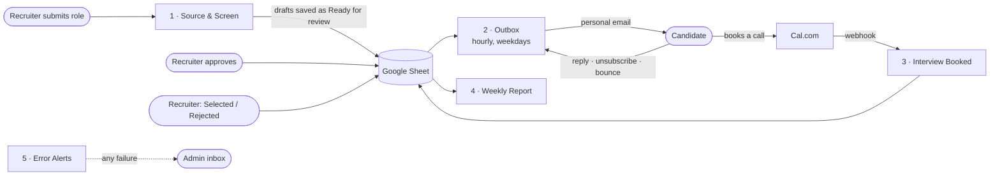

# Recruiting Agent

**An n8n automation that sources, screens and contacts candidates for recruiting agencies, while recruiters stay in control.**

A recruiter submits a job title in a form. The agent writes the job brief, finds matching public LinkedIn profiles, scores each one with AI, looks up work emails and drafts a personal first email for every good fit. Nothing is sent until a recruiter approves it in a Google Sheet. After that, the agent sends the email, follows up once, detects replies, opt-outs and bounces, logs interview bookings from Cal.com and emails a weekly pipeline report.

The recruiter does three things: **submit a role, approve the drafts, decide after the interview.**

---

## How it works



| Workflow | Trigger | What it does |
|---|---|---|
| **1 · Source and Screen** | Password-protected n8n form | AI writes the job brief and alternative titles → Serper (Google) search for public LinkedIn profiles → dedupes and skips anyone opted out or contacted recently → AI scores each profile 0–100 → Apollo finds work emails for the shortlist only → AI drafts a personal email with a booking link → saves rows as **Ready for review** and emails the recruiter a summary |
| **2 · Outbox** | Hourly, Mon–Fri, business hours | Sends **Approved** emails through the Gmail API. Reads each thread: reply → **Replied**, "unsubscribe" → **Opted out**, bounce → **Email bounced**. One follow-up in the same thread, then **No response**. Sends the Selected / Rejected update once. Enforces a rolling 24-hour sending limit |
| **3 · Interview Booked** | Cal.com webhook | Matches the booking to the candidate (by ID in the booking link, falling back to email), records the time and Meet link, handles reschedules and cancellations, alerts the recruiter |
| **4 · Weekly Report** | Mondays 9am | Funnel and reply rate per role, replies waiting on the recruiter, next week's interviews. Numbers are counted in code; AI only adds three suggested actions |
| **5 · Error Alerts** | Any workflow fails | Emails the admin the failed step and a link to the run |

## Design choices

- **Human in the loop.** No first email is sent without a recruiter changing the status to Approved. Drafts can be edited directly in the Sheet.
- **One Google Sheet as database and control panel.** Settings, email templates, jobs and candidates live in tabs the client already understands. A new client is configuration, not code.
- **Reputation protection.** Daily send cap, one follow-up only, unsubscribe footer plus `List-Unsubscribe` header, permanent opt-outs, bounce detection.
- **Fair, honest AI use.** The screening prompt sees only the public profile snippet and is told to ignore names and protected characteristics. AI never makes a decision and never writes the report's numbers.
- **Public data only.** Candidates are found through Google search results. The agent never logs into or scrapes LinkedIn.
- **Provider-agnostic AI.** Any OpenAI-compatible chat API works (OpenAI, Groq, Gemini) by changing two settings in the Sheet.
- **Failure handling.** Retries on external calls, soft failures where a step is optional (email lookup, AI suggestions), and an error workflow for everything else.

## Tech stack

n8n · JavaScript (Code nodes) · OpenAI-compatible LLM API (OpenAI / Groq) · Gmail API · Google Sheets API · Serper (Google Search API) · Apollo People Enrichment · Cal.com webhooks

## Repository layout

```
workflows/   five n8n workflow files to import
templates/   Google Sheet template (Settings, Templates, Jobs, Candidates) and a sample Cal.com booking payload
docs/        step-by-step setup guide
tests/       unit tests for every Code node, run against mock data
tools/       scripts that generate the workflow files and the Sheet template
```

## Getting started

Follow **[docs/SETUP.md](docs/SETUP.md)**. A full test setup can run for **$0** using free tiers (n8n Cloud trial, Groq, Serper, Apollo, Cal.com, Google).

## Testing

- **Code-node unit tests:** `node tests/code-nodes.test.js` runs every Code node against realistic mock data (Serper results, Apollo responses, Gmail threads, Cal.com payloads) and checks the edge cases: dedupe across LinkedIn subdomains, opt-out and cool-down skipping, daily send cap, reply / opt-out / bounce detection, booking matching, report counts and HTML escaping.
- **Node validation:** every node's type, version and parameters were checked against the definitions of an installed n8n (2.48.6).
- **End-to-end in the n8n engine:** six scenarios were run in a local n8n with external services mocked.
- **Live run:** tested end to end on n8n Cloud with real Google Sheets, Gmail, Serper, Groq and Cal.com accounts.

Bugs found and fixed through this testing include an API missing from n8n's Code-node sandbox, a report step that silently dropped data, Sheet cells that could be read as formulas, and search queries blocked on Serper's free plan.

## Running costs (production)

Roughly **$75–$100 a month** in tools for one recruiter: n8n Cloud Starter, Apollo Basic, a few cents of OpenAI per role and Serper credits. Prices vary; check each vendor.

## Limitations

- Screening uses only the public search snippet, so scores are a first pass for a human to review.
- Serper's free plan blocks `site:` and quoted searches, so free-plan searches are broader. Set `search_use_site` to `yes` on a paid plan.
- One recruiter mailbox and booking link per deployment. Several recruiters need one deployment each.
- Users are responsible for complying with email and hiring rules where they operate (e.g. CAN-SPAM, and local rules on automated hiring tools).

## License

MIT, see [LICENSE](LICENSE).

---

Built by **Saad Khan**.
